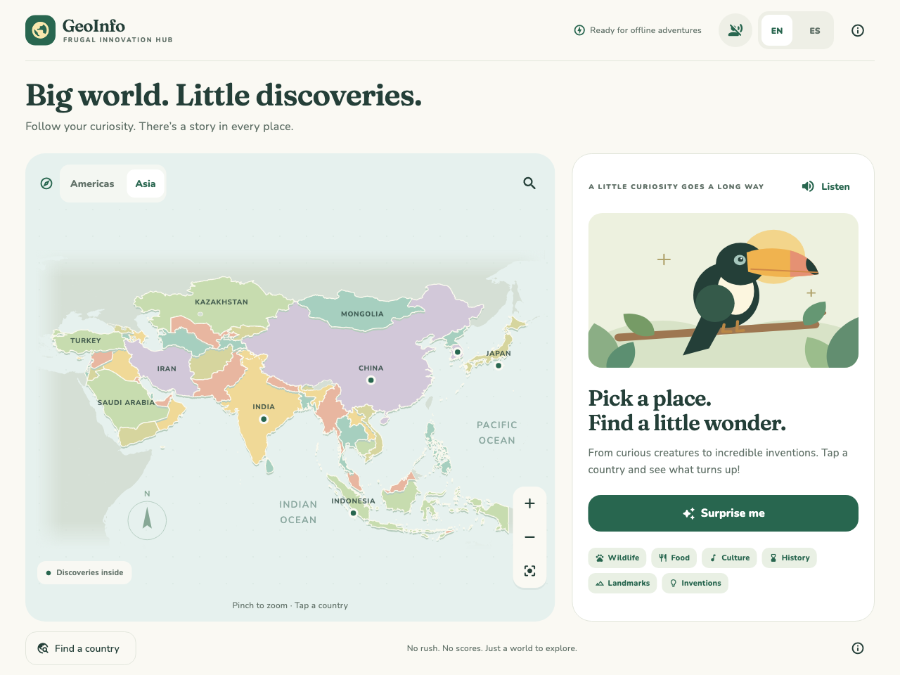
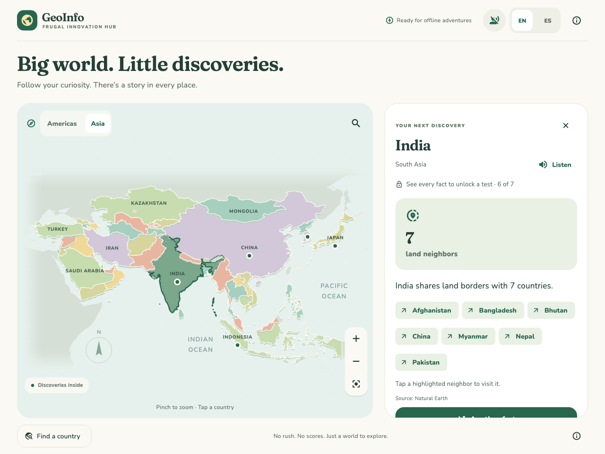
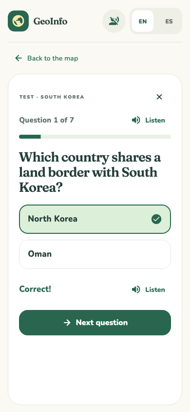

# GeoInfo

A Flutter prototype for Frugal Innovation Hub: a colorful, offline atlas of the Americas and Asia for ages 6–16. Tap a country and pull a surprise fact from its mixed collection. Switch between English and Latin American Spanish without changing the fact.

## What works

- Illustrated Americas (35 countries) and Asia (47 countries) maps, switched with an Americas/Asia toggle. Each keeps its own pan and zoom; pinch zoom, zoom buttons, reset, and geographic hit testing work on both.
- Searchable bilingual country list across both continents, including small Caribbean and Asian islands. Search works with or without accents, and picking a country switches to its continent.
- Twenty-two demonstration facts: ten across Brazil, Mexico, Peru, and the United States (covering all six subjects), and twelve across China, India, Indonesia, Japan, and South Korea. Every country with facts has at least two. Other countries have explicit preview states.
- Quick facts for all 82 countries: population, size, capital, and land neighbors. They are cards in the same “Another fact” rotation as the fun facts, so countries without fun facts still have four cards. Neighbors on the map can be tapped to visit them.
- A per-country test: once a child has seen every card for a country through “Another fact”, a “Take the test” button appears (with progress shown until then). Each fun fact has a hand-written two-option question; capital, population, size, and neighbor questions are generated from the quick-fact data. Every answer is marked right or wrong immediately, with a score at the end and a reshuffled retry. Nothing is saved.
- Read-aloud in English and Latin American Spanish: a “Listen” button on the welcome panel, every fact card, every test question, answer feedback, and the score, plus a header toggle that reads everything automatically as it appears. Narration plays pre-recorded clips bundled in `assets/audio/` (one per sentence, joined with short pauses) and falls back to the device's built-in voices for anything without a clip. It works offline and plays even with the silent switch on.
- Per-country shuffle bags: no repeats until the collection is exhausted; no immediate repeat on reshuffle.
- Clear empty and single-fact states, source credits, and a “Surprise me” option.
- English/Spanish UI and fact text; only the chosen language persists locally. There are no accounts, ads, analytics, or backend requests.
- Phone and tablet layouts, scrollable fact cards, larger text support, accessible controls, and original vector illustrations.
- Bundled map data, content, fonts, and artwork. Native app exploration requires no network connection or first-use content download.

Full educational content and App Store publication remain later milestones. This is a working interaction prototype, not a release candidate.

## Run

Built and tested with Flutter **3.47.2** / Dart **3.13.2**. The generated iOS project targets iOS **15.0+**; native compatibility has not yet been verified on devices.

```sh
flutter pub get
flutter run -d chrome
```

A temporary Flutter SDK was installed for this session at `/private/tmp/fih-flutter-sdk`. Until Flutter is installed permanently or added to PATH, replace `flutter` in commands with `/private/tmp/fih-flutter-sdk/bin/flutter`. The temporary SDK is outside this project and may be removed by the operating system later.

To view the compiled browser preview:

```sh
flutter build web --release --no-web-resources-cdn
python3 -m http.server 8080 --bind 127.0.0.1 --directory build/web
```

Open **http://127.0.0.1:8080**. The browser build is a development preview; it needs the local server. It is not an installable offline PWA. Its renderer is served locally instead of from a CDN.

For iPhone/iPad development, install and configure full Xcode, launch a simulator or connect a device, then run:

```sh
flutter devices
flutter run -d <device-id>
```

This Mac currently has command-line tools but no full Xcode installation, so no simulator build, signed IPA, or physical-device validation was performed. Follow [Flutter's iOS setup instructions](https://docs.flutter.dev/platform-integration/ios/setup) when setting up native testing. Choose your own publishing team and bundle identifier before distribution.

## Verify

```sh
flutter analyze
flutter test
flutter build web --release --no-web-resources-cdn
```

The 27 tests cover shuffle cycles and country isolation, bundled data integrity for both continents, deferred-area hit testing, map selection before and after zoom, continent switching, quick-fact data and number formatting in both languages, quick-fact cards and neighbor navigation, generated test questions for every country, speech text and read-aloud behavior (with a fake speaker), test unlocking, answer feedback, scoring, and retry, pinch/pan gestures, language/fact continuity, language-saving callbacks, accent-insensitive search, empty/single-fact states, preserved map zoom on return, landscape controls and keyboard layout, larger Spanish text, and five visual snapshots.

The rendered snapshots were visually inspected. They are Flutter test renders, not screenshots from an iPhone simulator. No connected browser was available for live-browser interaction checks. Saving the language through the native platform plugin still needs device verification.

After an intentional visual change, regenerate and inspect the snapshots:

```sh
flutter test --update-goldens
```









## Narration audio

Every sentence the app can read aloud is listed by `tool/export_speech.dart` and recorded by `tool/generate_speech.sh`:

```sh
tool/generate_speech.sh
```

The script picks the best installed macOS voice for US English and Mexican Spanish (Premium, then Enhanced, then Samantha/Paulina), records only new or changed sentences, removes clips for deleted text, and writes `assets/audio/index.json`. Clips are named by language and a hash of their text, so the app finds them without any extra mapping. Override voices or speed with `EN_VOICE`, `ES_VOICE`, `EN_RATE`, and `ES_RATE`. A test fails if any sentence is missing a clip, so rerun the script after editing any text.

For much better voices, download them first in **System Settings → Accessibility → Spoken Content → System voice → Manage Voices** (for example English (US) Ava or Zoe (Premium), Spanish (Mexico) Paulina (Enhanced)), then rerun the script.

**Prototype only:** macOS system voices are licensed for personal, non-commercial use. Before publishing, replace the `say` step with a text-to-speech service whose license allows distribution; the export and the app stay the same.

## Add content

Edit `assets/data/facts.json`; no screen changes are needed. Each fact has a unique `id`, a three-letter `country` identifier matching a country in `map.json` (either continent), one of the six topic tags, an illustration key, paired English/Spanish titles and bodies, and source/review metadata, and a `quiz` with a bilingual `question`, correct `answer`, and `wrong` option drawn only from the fact's own text. Both translations share one fact identifier.

Supported illustration keys: `toucan`, `axolotl`, `mountains`, `music`, `food`, `basketball`. These are reusable illustrative scenes, not precise depictions of every landmark. Facts and translations are examples awaiting editorial review.

## Project layout

| File | Purpose |
| --- | --- |
| `lib/main.dart` | Load bundled assets and saved language; startup/retry handling |
| `lib/app.dart` | App state, adaptive screens, fact cards, language controls |
| `lib/models.dart` | Data loading, geographic paths, per-country shuffle bags |
| `lib/strings.dart` | Bilingual UI copy and number formatting |
| `lib/narrator.dart` | Read-aloud playback (recorded clips, then device voices), Listen buttons, and automatic reading |
| `lib/speech_script.dart` | Everything the app reads aloud, split into parts, and clip keys |
| `tool/export_speech.dart`, `tool/generate_speech.sh` | List every spoken sentence and record clips into `assets/audio/` |
| `lib/quiz.dart` | Test question generation and the two-option test card |
| `lib/widgets/atlas_map.dart` | Continent switch, map drawing, per-continent decoration, pan/zoom, hit testing, semantics |
| `lib/widgets/country_picker.dart` | Search and country selection |
| `lib/widgets/discovery_art.dart` | Original local vector illustrations |
| `assets/data/` | Bundled per-continent map data, demonstration facts, and quick facts (`profiles.json`) |
| `tool/prepare_profiles.cjs` | Reproducible quick-fact build from World Bank and Natural Earth files |
| `tool/prepare_map.cjs` | Reproducible map-data conversion from source files |
| `tool/generate_icons.dart` | Render original app icons into platform asset slots |

See [DATA_SOURCES.md](DATA_SOURCES.md) for source attribution, geographic deferrals, and reproduction details. Product decisions remain in [PROJECT_PLAN.md](PROJECT_PLAN.md).
