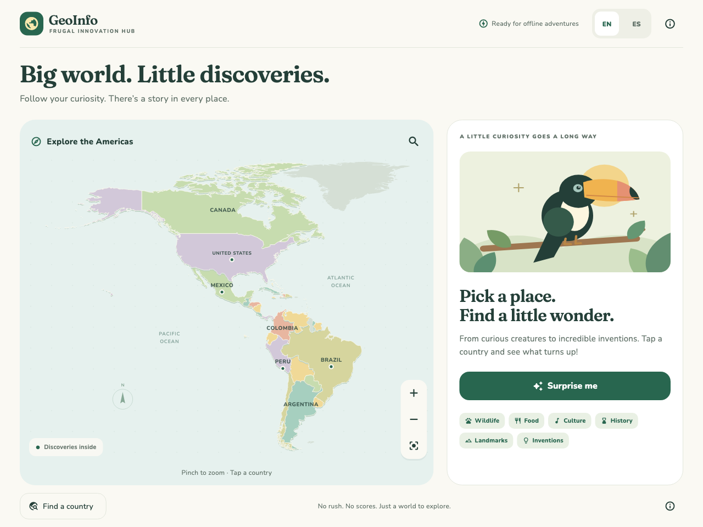
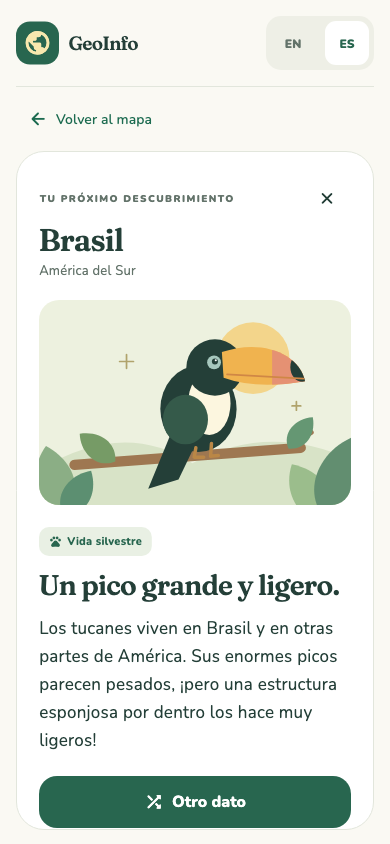

# GeoInfo

A Flutter prototype for Frugal Innovation Hub: a colorful, offline atlas for ages 6–16. Tap a country and pull a surprise fact from its mixed collection. Switch between English and Latin American Spanish without changing the fact.

## What works

- An illustrated Americas map with 35 country entries, pan, pinch zoom, zoom buttons, reset, and geographic hit testing.
- Searchable bilingual country list, including small Caribbean islands. Search works with or without accents.
- Eight demonstration facts across Brazil, Mexico, Peru, and the United States, collectively covering all six subjects. Other countries have explicit preview states.
- Per-country shuffle bags: no repeats until the collection is exhausted; no immediate repeat on reshuffle.
- Clear empty and single-fact states, source credits, and a “Surprise me” option.
- English/Spanish UI and fact text; only the chosen language persists locally. There are no accounts, ads, analytics, or backend requests.
- Phone and tablet layouts, scrollable fact cards, larger text support, accessible controls, and original vector illustrations.
- Bundled map data, content, fonts, and artwork. Native app exploration requires no network connection or first-use content download.

Full educational content and App Store publication remain later milestones. This is a working interaction prototype, not a release candidate.

## Run

Built and tested with Flutter **3.47.2** / Dart **3.13.2**. The generated iOS project targets iOS **15.0+**; native compatibility has not yet been verified on devices.

```sh
flutter pub get
flutter run -d chrome
```

A temporary Flutter SDK was installed for this session at `/private/tmp/fih-flutter-sdk`. Until Flutter is installed permanently or added to PATH, replace `flutter` in commands with `/private/tmp/fih-flutter-sdk/bin/flutter`. The temporary SDK is outside this project and may be removed by the operating system later.

To view the compiled browser preview:

```sh
flutter build web --release --no-web-resources-cdn
python3 -m http.server 8080 --bind 127.0.0.1 --directory build/web
```

Open **http://127.0.0.1:8080**. The browser build is a development preview; it needs the local server. It is not an installable offline PWA. Its renderer is served locally instead of from a CDN.

For iPhone/iPad development, install and configure full Xcode, launch a simulator or connect a device, then run:

```sh
flutter devices
flutter run -d <device-id>
```

This Mac currently has command-line tools but no full Xcode installation, so no simulator build, signed IPA, or physical-device validation was performed. Follow [Flutter's iOS setup instructions](https://docs.flutter.dev/platform-integration/ios/setup) when setting up native testing. Choose your own publishing team and bundle identifier before distribution.

## Verify

```sh
flutter analyze
flutter test
flutter build web --release --no-web-resources-cdn
```

The 14 tests cover shuffle cycles and country isolation, bundled data integrity, deferred-area hit testing, map selection before and after zoom, pinch/pan gestures, language/fact continuity, language-saving callbacks, accent-insensitive search, empty/single-fact states, preserved map zoom on return, landscape controls and keyboard layout, larger Spanish text, and two visual snapshots.

The rendered snapshots were visually inspected. They are Flutter test renders, not screenshots from an iPhone simulator. No connected browser was available for live-browser interaction checks. Saving the language through the native platform plugin still needs device verification.

After an intentional visual change, regenerate and inspect the snapshots:

```sh
flutter test --update-goldens
```





## Add content

Edit `assets/data/facts.json`; no screen changes are needed. Each fact has a unique `id`, a three-letter `country` identifier matching `map.json`, one of the six topic tags, an illustration key, paired English/Spanish titles and bodies, and source/review metadata. Both translations share one fact identifier.

Supported illustration keys: `toucan`, `axolotl`, `mountains`, `music`, `food`, `basketball`. These are reusable illustrative scenes, not precise depictions of every landmark. Facts and translations are examples awaiting editorial review.

## Project layout

| File | Purpose |
| --- | --- |
| `lib/main.dart` | Load bundled assets and saved language; startup/retry handling |
| `lib/app.dart` | App state, adaptive screens, fact cards, language controls |
| `lib/models.dart` | Data loading, geographic paths, per-country shuffle bags |
| `lib/strings.dart` | Bilingual UI copy |
| `lib/widgets/atlas_map.dart` | Map drawing, pan/zoom, hit testing, semantics |
| `lib/widgets/country_picker.dart` | Search and country selection |
| `lib/widgets/discovery_art.dart` | Original local vector illustrations |
| `assets/data/` | Bundled map and demonstration facts |
| `tool/prepare_map.cjs` | Reproducible map-data conversion from source files |
| `tool/generate_icons.dart` | Render original app icons into platform asset slots |

See [DATA_SOURCES.md](DATA_SOURCES.md) for source attribution, geographic deferrals, and reproduction details. Product decisions remain in [PROJECT_PLAN.md](PROJECT_PLAN.md).
